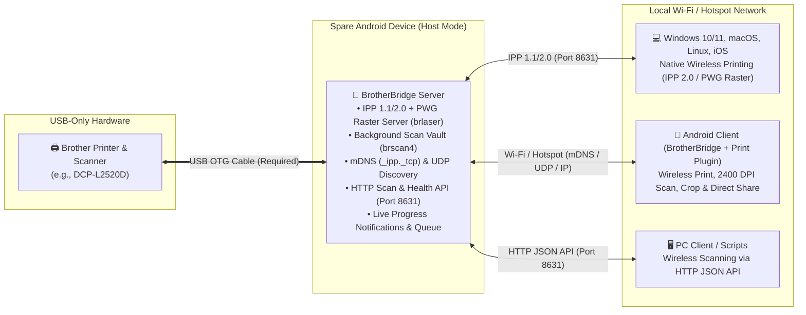
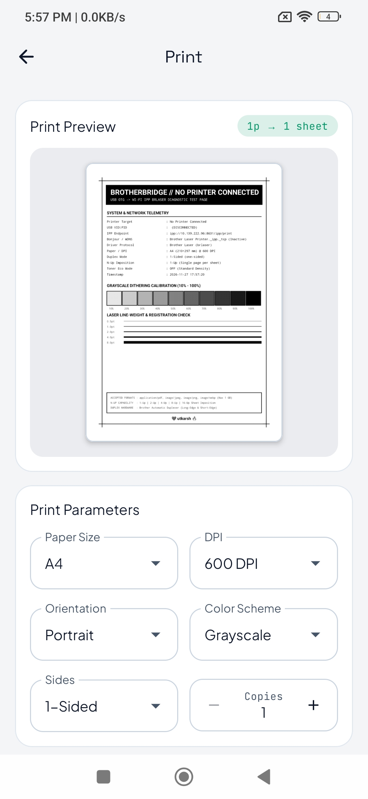
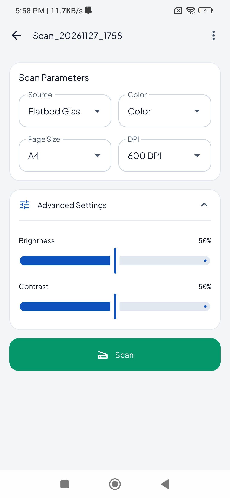
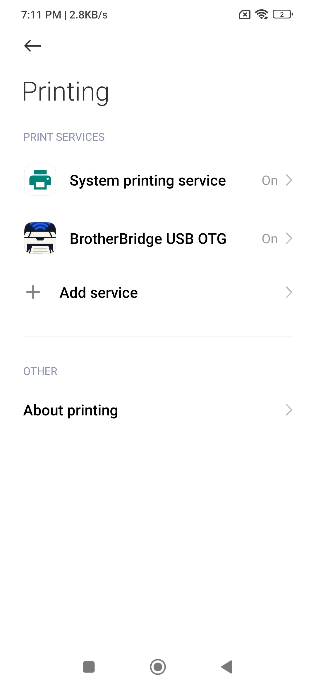

<div align="center">

<h2>🖨️ BrotherBridge (v1.9.0)</h2>

[](https://aistudio.google.com/docs/models/gemini-4-neon)

**Breathe new life into your old USB-only Brother printer & scanner using a spare Android phone.**

</div>

*Turn any old Android device + USB OTG cable into a wireless IPP 2.0 Print Server (`brlaser`) and High-Resolution Network Scanner (`brscan4`).*

<div align="center">

[](#)
[](#)
[](#)
[](#)
[](#)

[Features](#-key-features) • [Architecture](#-architecture) • [Host Rules](#%EF%B8%8F-host-mode-rules--requirements) • [PC Wireless Setup](#-connecting-wirelessly-from-a-pc) • [HTTP Scan API](#-pc-scanning-http-api) • [Compatibility](#-compatibility--expected-devices) • [Quick Start](#-quick-start-guide)

---

</div>

## 🌟 Overview

Many rock-solid monochrome laser printers and multifunction scanners—like the **Brother DCP-L2520D**—still work flawlessly after years of use, yet lack built-in Wi-Fi. Instead of replacing a great printer or maintaining a Raspberry Pi / always-on PC, you can repurpose a spare Android phone sitting in your drawer.

By connecting your printer to an Android device via a **USB OTG cable**, **BrotherBridge** turns the phone into a dedicated **Wi-Fi Print & Scan Server** powered under the hood by native Kotlin ports of **`brlaser`** (printing) and **`brscan4`** (scanning):

* **Direct USB OTG & Wireless Printing (`brlaser` + IPP 1.1/2.0):** Print directly from Windows 10/11, macOS, Linux, iOS, and Android over Wi-Fi or Hotspot—no proprietary Brother PC drivers needed.
* **Built-In Android Print Service Plugin:** Print from Chrome, Google Drive, Files, Photos, Gmail, or any Android app. Once connected wirelessly, the print plugin stays active even after you close the app until the host goes offline or you manually disconnect.
* **Fail-Safe Wireless Scanning (`brscan4`):** Scan documents wirelessly at up to **2400 DPI** using the same app in **Client Mode**, or scan from your computer using the built-in **HTTP Scan API** (or the companion PC client).
* **Live Progress & Instant Editing:** Track active printing and scanning jobs with live foreground notifications, crop scanned pages with a 4-corner perspective editor, merge pages (e.g., 2-in-1 ID cards), and export or share as **JPG**, **PNG**, or **PDF**.

---

## 🏗️ Architecture



---

## ✨ Key Features

### 🖨️ Direct USB OTG & Wireless Printing (`brlaser` + IPP 2.0)
* **Native Cross-Platform IPP Server:** Exposes an RFC 8011 **IPP 1.1 / 2.0** server on port **`8631`** (`/ipp/print`) supporting `application/pdf`, **`image/pwg-raster`** (native Windows 10/11 *Microsoft IPP Class Driver* support), `image/jpeg`, `image/png`, and `image/webp`.
* **Zero-Config Discovery + Manual Fallback:** Advertises automatically via **mDNS / Bonjour (`_ipp._tcp`)** and **UDP discovery beacons**, with manual **IP:Port** connection whenever a router or hotspot blocks multicast.
* **Rich In-App Print Controls & Live Sheet Preview:**
  * Paper sizes: `A4`, `Letter`, `Legal`, `A5`, `B5`
  * Resolutions: `300`, `600`, and `1200 DPI`
  * Orientation (Portrait / Landscape), Color Scheme (**Grayscale** halftone vs crisp **2-Bit B&W**), Duplex (Long-Edge / Short-Edge), Copies (`1–99`), and **Toner Save (Eco)** mode
  * **N-Up Imposition:** `1`, `2`, `4`, `6`, `9`, or `16` pages per sheet with optional page borders
  * **Image Layout Controls:** Adjustable page margins (`0–25 mm` + quick presets) and **Fit Page** vs **Full Page (Crop)** with drag-to-pan preview positioning
* **Persistent Android System Print Service Plugin:** Enable **BrotherBridge** in Android *Settings → Printing* to print from any app on your phone—works for both direct USB OTG and wireless connections, and stays connected after closing the app until the host goes offline or you tap **Disconnect Device**.

### 📄 High-Resolution Scanning (`brscan4`) & Built-In Editor
* **Up to 2400 DPI:** Selectable scan presets (`150`, `300`, `600`, `1200`, `2400 DPI`), Color / Grayscale / Black & White modes, Brightness & Contrast adjustments, and Flatbed / ADF support (where hardware allows).
* **Fail-Safe Background Scanning & Recovery:** Scans run safely in a background foreground service with live progress notifications and **SHA-256 integrity verification**—you can switch apps while scanning, and uncollected wireless scans are automatically recovered when you reconnect.
* **Built-In Page Editor & Organization:**
  * **4-Corner Perspective Crop Editor** with one-tap **Auto Adjust**, Reset, and Undo/Redo
  * **Page Merge (2-in-1 ID Cards & Collages):** Select two or more scanned pages to combine them neatly onto a single page
  * **90° Rotation, Zoom Viewer & Flexible Layouts:** Switch between **Grid**, **Small Tiles**, and **List** views
  * **Flexible Export & Share:** Save or share individual pages or entire sessions as **JPG**, **PNG**, or multi-page **PDF** (including choosing a custom save folder)
  * **Offline Scan Library:** Access, edit, crop, rotate, or re-export past scans from Home / All Scans even when no printer is connected.

### 🩺 Printer Health, Queue & Multi-Language UI
* **Live Printer Health & Telemetry:** Monitor toner level, drum life, paper tray status, and device counters over USB OTG or remotely via `/api/status`.
* **Print Queue, Connected Clients & Protocol Logs:** Track active/completed jobs, cancel queued jobs, view connected Wi-Fi clients on the host dashboard, and inspect live protocol logs.
* **Safe Disconnect:** Disconnect from any connected device via the Home 3-dot menu—with an automatic confirmation popup if a print or scan job is currently in progress.
* **18 Built-In Languages:** English (US/CA/IN/AU/GB), Hindi, Japanese, German, French, Simplified Chinese, Spanish, Indonesian, Vietnamese, Thai, Swedish, Danish, Norwegian, and Finnish.

---

## ⚠️ Host Mode Rules & Requirements

To ensure reliable, uninterrupted operation as a wireless print and scan server, **Host Mode** relies on two key requirements:

| Rule | Requirement | Why It's Required |
| :--- | :--- | :--- |
| **1. Active USB OTG Connection** | The host Android device **must** support USB OTG and be physically connected to the Brother printer/scanner via an OTG cable/adapter. | The Remote Server shares the attached USB printer & scanner; without an active USB OTG connection and granted USB permission, Host Mode cannot serve print or scan jobs. |
| **2. Unrestricted Background Battery** | Set Battery usage to **Unrestricted** (disable Android Battery Optimization) for BrotherBridge on the host device. | Android aggressively suspends background services when the screen turns off. Unrestricted battery + foreground keep-alive locks keep the IPP server, mDNS advertiser, and HTTP Scan API reachable 24/7. |

> 💡 **Pro Tip:** Enable **Auto-Start Server on USB OTG** in *Settings* so the wireless server starts automatically the moment you plug in the printer. Consider using a **USB OTG Power Y-Splitter / Powered Hub** (if supported by your phone) so your host device stays charged continuously.

---

## 📊 Capabilities at a Glance

| Category | Capability | Details |
| :--- | :--- | :--- |
| **Connection (Host)** | USB OTG (Mandatory) | Connects directly to USB-only Brother printers/scanners |
| **Print Driver Engine** | `brlaser` | Monochrome Brother laser PJL + 1030m raster compression |
| **Scan Driver Engine** | `brscan4` | Brother 4th-gen USB scan protocol with Flatbed & ADF support |
| **Network Discovery** | mDNS, UDP & Static IP | Auto-discoverable on Wi-Fi / Hotspot or via manual IP:Port |
| **Printing Protocol** | IPP 1.1 / 2.0 + PWG Raster | Native printing from Windows 10/11, macOS, Linux, iOS, Android |
| **Android Print Plugin** | Persistent PrintService | Prints from any Android app; stays connected after closing the app |
| **Max Scan Resolution** | Up to 2400 DPI | `150`, `300`, `600`, `1200`, `2400 DPI` (Color / Grayscale / B&W) |
| **Scan Editing Tools** | Crop, Merge & Rotate | 4-corner perspective crop, Auto Adjust, page merge, 90° rotate |
| **Export Formats** | JPG, PNG, PDF | Single-page images, multi-page PDFs, and Save As to any folder |
| **PC Integration** | IPP + HTTP JSON Scan API | Driverless PC printing + asynchronous HTTP scan API & PC client |
| **Localization** | 18 Languages | Full UI localization with instant in-app language switching |

---

## 📸 Screenshots

| Home | Print Preview & Controls | Scan Controls | Print Service Plugin |
| :---: | :---: | :---: | :---: |
|  |  |  |  |
| *USB OTG status, connected clients, IP & mDNS* | *Live sheet preview, N-Up, margins & duplex* | *Up to 2400 DPI, 4-corner crop & auto-adjust* | *Grid/Tiles/List view, merge & PDF export* |

---

## ✅ Compatibility & Expected Devices

> ⚠️ **Testing Notice:** BrotherBridge was developed and verified primarily on the **Brother DCP-L2520D**. Because it uses the **`brlaser`** driver for printing and **`brscan4`** for scanning, the devices listed below are **expected to work**, though they remain untested by the author.

### 1. Tested & Confirmed
| Model | Print (`brlaser`) | Scan (`brscan4`) | Status |
| :--- | :---: | :---: | :--- |
| **Brother DCP-L2520D** | ✅ Tested | ✅ Tested | Primary development & verified test device |

### 2. Expected Full Compatibility (Print + Scan)
*Multifunction monochrome laser printers supported by **both** `brlaser` and `brscan4`:*

| Brother Series | Expected Models | Print (`brlaser`) | Scan (`brscan4`) |
| :--- | :--- | :---: | :---: |
| **DCP-L2500 Series** | `DCP-L2500D`, `DCP-L2510D`, `DCP-L2520DW`, `DCP-L2540DW`, `DCP-L2550DW` | 🟡 Expected | 🟡 Expected |
| **DCP-1500 / 1600 Series** | `DCP-1510`, `DCP-1512`, `DCP-1600`, `DCP-1610W` | 🟡 Expected | 🟡 Expected |
| **DCP-7055–7080 Series** | `DCP-7055`, `DCP-7055W`, `DCP-7060D`, `DCP-7065DN`, `DCP-7070DW`, `DCP-7080` | 🟡 Expected | 🟡 Expected |
| **MFC-1800 / 1900 Series** | `MFC-1810`, `MFC-1815`, `MFC-1910W` | 🟡 Expected | 🟡 Expected |
| **MFC-7000 Series** | `MFC-7240`, `MFC-7360N`, `MFC-7365DN`, `MFC-7460DN`, `MFC-7860DW` | 🟡 Expected | 🟡 Expected |
| **MFC-L2700 Series** | `MFC-L2700DN`, `MFC-L2700DW`, `MFC-L2710DN`, `MFC-L2710DW`, `MFC-L2750DW` | 🟡 Expected | 🟡 Expected |

### 3. Expected Partial Compatibility (Print-Only or Scan-Only)
| Category | Expected Models | Print (`brlaser`) | Scan (`brscan4`) | Notes |
| :--- | :--- | :---: | :---: | :--- |
| **Brother HL Laser Printers** | `HL-1110`, `HL-1200`, `HL-2030`, `HL-2130`, `HL-2140`, `HL-2220`, `HL-2240D`, `HL-2270DW`, `HL-5030`, `HL-L2300D`, `HL-L2320D`, `HL-L2340D`, `HL-L2360D`, `HL-L2375DW`, `HL-L2390DW` | 🟡 Expected | ➖ N/A | Single-function printers (Scan button hides automatically) |
| **Older `brscan3` MFPs** | `DCP-7030`, `DCP-7040`, `MFC-7320`, `MFC-7340`, `MFC-7420`, `MFC-7440N` | 🟡 Expected | ❌ Unsupported | Printing uses `brlaser`, but scanning requires `brscan3` |
| **Other `brscan4` Inkjet / Color MFPs** | USB `DCP-T`, `DCP-J`, `MFC-J` series listed under Brother `brscan4` | ❌ Unsupported | 🟡 Expected | `brlaser` supports monochrome lasers only; scanning may still work |

*Tested BrotherBridge on another Brother model? Please open an **Issue** or **Pull Request** with your model number and results so we can update this compatibility matrix!*

---

## 🚀 Quick Start Guide

### Prerequisites
* A compatible USB-only Brother printer/scanner (e.g., **DCP-L2520D**).
* A spare Android device (Host) running Android 7.0+ with **USB OTG** support.
* A **USB OTG adapter/cable** *(or powered OTG Y-splitter cable)*.
* A shared Wi-Fi network or mobile hotspot for your Host device and Client devices.

### 1. Set Up the Host Device (Server)
1. Install **BrotherBridge** on your spare Android device.
2. Connect your Brother printer to the phone via the **USB OTG cable** and tap **Allow** on the Android USB permission prompt.
3. Set Battery usage to **Unrestricted** in Android *App Info → Battery* for reliable 24/7 background hosting.
4. Tap **Server** on the Home screen and toggle the **Remote Server** ON *(or enable Auto-Start on USB OTG in Settings)*.
5. Note the displayed **IP Address** and port (default **`8631`**), e.g., `http://192.168.1.50:8631/ipp/print`.

### 2. Connect Wirelessly from Another Android Phone
1. Install **BrotherBridge** on your daily Android phone/tablet connected to the same Wi-Fi or Hotspot.
2. On the Home screen, tap **Scan for Printers** to discover the host automatically via mDNS/UDP—or open the top-right **3-dot menu → Add IP Manually!** and enter `<HOST_IP>` and port `8631`.
3. Once connected, tap **Print** or **Scan** directly in the app, or enable **BrotherBridge** in Android *Settings → Printing* to print from any other app (the print plugin remains connected even after closing BrotherBridge until the host goes offline or you tap **3-dot menu → Disconnect Device**).

---

## 🖥️ Connecting Wirelessly from a PC

Make sure your PC and the Android Host phone (with **Remote Server** running) are on the **same Wi-Fi network**. You can verify connectivity at any time by opening `http://<HOST_IP>:8631/` in your PC's web browser.

### 1. Wireless Printing on Windows 10 / 11
BrotherBridge implements full **IPP 2.0**, HTTP chunked transfer decoding, `Expect: 100-continue`, IEEE 1284 Device ID, and **`image/pwg-raster`** decoding specifically for Windows' built-in **Microsoft IPP Class Driver**—no Brother Windows driver install required.

* **Option A — Automatic Discovery (mDNS):**
  1. Open **Settings → Bluetooth & devices → Printers & scanners → Add device**.
  2. Wait a few seconds for **BrotherBridge** to appear and click **Add device**.
* **Option B — Add Manually by URL (Recommended if mDNS is blocked):**
  1. Open **Settings → Bluetooth & devices → Printers & scanners → Add device → Add manually**.
  2. Choose **Select a shared printer by name** and enter:
     ```text
     http://<HOST_IP>:8631/ipp/print
     ```
  3. Click **Next**. If prompted for a driver, pick **Microsoft → Microsoft IPP Class Driver** and finish setup.
* **Option C — One-Line PowerShell Setup:**
  ```powershell
  Add-Printer -IppURL "http://<HOST_IP>:8631/ipp/print"
  ```

### 2. Wireless Printing on macOS
* **Automatic (Bonjour):** Open **System Settings → Printers & Scanners → Add Printer**, choose **BrotherBridge** under the **Default** tab, keep **Use: AirPrint / Generic PDF Printer**, and click **Add**.
* **Manual (IP Tab):**
  * **Protocol:** `Internet Printing Protocol - IPP`
  * **Address:** `<HOST_IP>:8631`
  * **Queue:** `ipp/print`
  * **Use:** `Generic PDF Printer` → click **Add**.

### 3. Wireless Printing on Linux (CUPS)
* **Automatic:** Open **Settings → Printers → Add** (CUPS/Avahi discovers `_ipp._tcp` automatically).
* **Manual (CUPS CLI or `http://localhost:631`):**
  ```bash
  lpadmin -p BrotherBridge -E -v ipp://<HOST_IP>:8631/ipp/print -m everywhere
  ```

### 4. Wireless Scanning from a PC (Desktop Client & API)
Want a ready-to-use desktop GUI/CLI utility to discover your BrotherBridge host and scan wirelessly from Windows, macOS, or Linux without installing `brscan4`?

> 🔗 **Companion PC Wireless Scan Client:** [https://github.com/your-username/BrotherBridge-PC-Client](https://github.com/your-username/BrotherBridge-PC-Client) *(dummy reference URL — replace with your PC client repository link)*

You can also integrate directly with the Host phone from any script or custom tool using the built-in **HTTP Scan API** below (see [PC_SETUP_AND_SCAN_API.md](PC_SETUP_AND_SCAN_API.md) for the quick reference guide).

---

## 💻 PC Scanning (HTTP API)

The host server exposes an asynchronous, fail-safe **HTTP/JSON Scan API** on port **`8631`** with SHA-256 checksum verification and automatic recovery for unacknowledged scans. Pick any unique `deviceId` for your PC (3–64 alphanumeric, `_`, or `-` characters, e.g., `my_pc_01`).

| Method | Endpoint | Description |
| :--- | :--- | :--- |
| `GET` | `/api/status` | Check USB OTG connection, model name, toner/drum/paper health, and server status |
| `GET` | `/api/scan/capabilities` | Query scanner availability, busy state, flatbed/ADF support, and model |
| `POST` | `/api/scan/start` | Start (or queue) a scan job; returns HTTP `202` with a `jobId` |
| `GET` | `/api/scan/jobs/<jobId>/progress?deviceId=<id>` | Poll job status (`QUEUED` → `RUNNING` → `READY` / `FAILED` / `CANCELED`) and page metadata |
| `GET` | `/api/scan/jobs/<jobId>/page/<index>?deviceId=<id>` | Download scanned page (`image/jpeg`) with `X-Scan-Sha256` & `X-Scan-Size-Bytes` headers |
| `POST` | `/api/scan/jobs/<jobId>/ack` | Acknowledge verified receipt (`sha256` + `receivedBytes`) so the host clears its vault copy |
| `GET` | `/api/scan/pending?deviceId=<id>` | Recover any completed but unacknowledged scans after a disconnect |
| `POST` | `/api/scan/jobs/<jobId>/cancel` | Cancel an active or queued scan job |

### Example Workflow (`curl`)
```bash
# 1. Start a 300 DPI color flatbed scan (returns JSON with "jobId")
curl -X POST "http://<HOST_IP>:8631/api/scan/start" \
  -H "Content-Type: application/json" \
  -d '{
    "deviceId": "my_pc_01",
    "clientName": "My PC",
    "source": "FLATBED",
    "colorMode": "COLOR",
    "dpi": 300,
    "pageSize": "A4",
    "brightness": 50,
    "contrast": 50
  }'

# 2. Poll progress until status is "READY"
curl "http://<HOST_IP>:8631/api/scan/jobs/<JOB_ID>/progress?deviceId=my_pc_01"

# 3. Download page 1 as JPEG
curl "http://<HOST_IP>:8631/api/scan/jobs/<JOB_ID>/page/1?deviceId=my_pc_01" \
  --output scanned_page_1.jpg

# 4. Acknowledge receipt (cleans up the host vault copy)
curl -X POST "http://<HOST_IP>:8631/api/scan/jobs/<JOB_ID>/ack" \
  -H "Content-Type: application/json" \
  -d '{
    "deviceId": "my_pc_01",
    "pageIndex": 1,
    "sha256": "<SHA256_OF_SCANNED_PAGE_1>",
    "receivedBytes": 123456
  }'
```

---

## 🛠️ Troubleshooting

* **Remote Server won't start?** Verify that (1) the printer is powered on and physically connected via a working **USB OTG cable** with USB permission granted, and (2) **Unrestricted Background Battery Usage** is enabled in Android *App Info → Battery*.
* **Server stops when the host screen turns off?** Some Android OEMs (Xiaomi/MIUI, Samsung, OnePlus, Vivo, Oppo) enforce aggressive background limits. Lock BrotherBridge in Recent Apps and disable *"Pause app activity if unused"* alongside Unrestricted Battery.
* **Windows or mobile doesn't auto-discover via mDNS?** Some routers or mobile hotspots block multicast traffic (AP Isolation or cross-band 2.4 GHz / 5 GHz isolation). Add the printer manually using `http://<HOST_IP>:8631/ipp/print` (PC) or **Add IP Manually!** (Android client).
* **Wireless Print Plugin shows disconnected?** Confirm the Host phone is still online on the same Wi-Fi network. BrotherBridge keeps the Android Print Service plugin connected even after you close the app, and only disconnects automatically if the host goes offline or you manually choose **Disconnect Device**.

---

## 🤝 Contributing

Contributions, bug reports, and **printer/scanner compatibility reports** are warmly welcome!

1. Fork the repository.
2. Create a feature branch (`git checkout -b feature/amazing-feature`).
3. Commit your changes (`git commit -m 'Add amazing feature'`).
4. Push to the branch (`git push origin feature/amazing-feature`).
5. Open a Pull Request.

---

## 📄 License

This project is licensed under the **GNU General Public License v2.0 (GPL-2.0)** — see the [LICENSE](LICENSE) file for details.

### Third-Party Attributions & Derivative Works

This application includes Kotlin ports and adaptations of open-source C/C++ printer and scanner drivers:

* **Printing (`brlaser`)** — Ported from [brlaser](https://github.com/pdewacht/brlaser) (licensed under GPL-2.0-or-later).
* **Scanning (`brscan4`)** — Ported from open-source C implementations of the Brother SANE `brscan4` protocol (licensed under GPL-2.0).

*Disclaimer: This is an independent open-source project and is not affiliated with, endorsed by, or supported by Brother Industries, Ltd. All product names and trademarks belong to their respective owners.*
