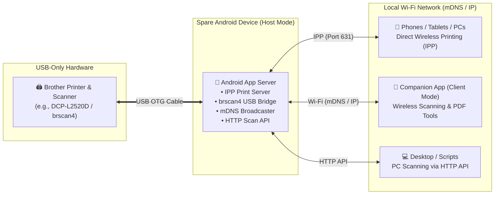

<div align="center">

# 🖨️ BrWiFi Bridge *(Replace with your App Name)*

**Breathe new life into your old USB-only Brother printer & scanner using a spare Android phone.**

[](#)
[](#)
[](#)
[](#)

*Turn any old Android device + USB OTG cable into a wireless IPP Print Server and High-Resolution Network Scanner.*

[Features](#-key-features) • [How It Works](#-architecture) • [Screenshots](#-screenshots) • [Compatibility](#-compatibility) • [Setup Guide](#-quick-start-guide) • [HTTP API](#-pc-scanning-http-api)

</div>

---

## 🌟 Overview

Many rock-solid laser printers and multifunction scanners—like the **Brother DCP-L2520D**—still work flawlessly after years of use, but they lack built-in Wi-Fi. Instead of buying a new printer or setting up a bulky Raspberry Pi / always-on PC, you can repurpose an old Android phone sitting in your drawer.

By connecting your printer to an Android device via a **USB OTG cable**, this app turns the phone into a dedicated **Wi-Fi Print & Scan Server**:
* **Wireless Printing (IPP):** Print directly from Android, iOS, Windows, macOS, and Linux over Wi-Fi—no extra drivers or client apps needed on the printing device.
* **Wireless Scanning:** Scan documents wirelessly at up to **2400 DPI** using the same app in **Client Mode**, or trigger scans directly from your PC via the built-in **HTTP API**.

---

## 🏗️ Architecture



---

## ✨ Key Features

### 🖨️ Wireless Printing
* **Standard IPP Support:** Uses the Internet Printing Protocol (IPP), allowing native wireless printing from virtually any modern OS.
* **Zero-Config Discovery:** Broadcasts automatically on your local network via **mDNS (Bonjour / ZeroConf)**, with manual **IP address** fallback.

### 📄 High-Resolution Wireless Scanning
* **Up to 2400 DPI:** Capture crisp text, graphics, and fine details with selectable resolution presets all the way up to **2400 DPI**.
* **2-in-1 ID Card Scanning:** Dedicated workflow to scan the front and back of ID cards, licenses, or passports and automatically arrange them neatly onto a single page.
* **Continuous Multi-Page Scanning:** Keep scanning page after page in a single session to seamlessly compile multi-page PDF documents.
* **Flexible Export Formats:** Save and share your scans as **JPG**, **PNG**, or **PDF**.
* **PC Scanning via HTTP API:** Integrate with your desktop workflow or scripts to pull scans straight to your computer over the network.

---

## 📊 Capabilities at a Glance

| Category | Capability | Details |
| :--- | :--- | :--- |
| **Connection (Host)** | USB OTG | Connects directly to USB-only Brother printers/scanners |
| **Network Discovery** | mDNS & Static IP | Auto-discoverable on LAN or connectable via direct IP |
| **Printing Protocol** | IPP | Native printing from Android, Windows, macOS, Linux, iOS |
| **Scanning Protocol** | `brscan4` (over Wi-Fi) | Requires the companion app on mobile or HTTP API on PC |
| **Max Scan Resolution** | Up to 2400 DPI | Configurable DPI for quick drafts or archival quality |
| **Special Scan Modes** | 2-in-1 ID & Continuous | Side-by-side/stacked ID layout & multi-page document builder |
| **Export Formats** | JPG, PNG, PDF | Single image exports and multi-page PDF compilation |
| **PC Integration** | HTTP API | Trigger and download scans from any PC on the same Wi-Fi |

---

## 📸 Screenshots

> *Screenshots will be attached here soon.*

| Host Server Dashboard | Wireless Scan Client | 2-in-1 ID Card Mode | Multi-Page PDF Builder |
| :---: | :---: | :---: | :---: |
|  |  |  |  |
| *OTG connection status, IP & mDNS info* | *DPI selection & live scan preview* | *Front & back ID alignment* | *Continuous scan & export options* |

---

## ✅ Compatibility

> ⚠️ **Important Notice:** This app was built specifically for **Brother DCP-L2520D** class devices and has **only been tested on the Brother DCP-L2520D**. Other USB-only Brother printers and `brscan4`-compatible scanners may work, but are currently untested.

| Device / Series | Protocol | Print Status | Scan Status | Notes |
| :--- | :--- | :---: | :---: | :--- |
| **Brother DCP-L2520D** | USB / `brscan4` | ✅ Tested | ✅ Tested | Primary development & test device |
| **Other `brscan4` Brother MFPs** | USB / `brscan4` | 🧪 Untested | 🧪 Untested | Expected to work; feedback welcome! |
| **Non-Brother USB Printers** | USB | ❓ Unknown | ❌ Unsupported | Scanning relies on `brscan4` commands |

*Have you tested this app on another Brother model? Please open an Issue or Pull Request to help expand this list!*

---

## 🚀 Quick Start Guide

### Prerequisites
* A USB-only Brother printer/scanner (e.g., **DCP-L2520D**).
* A spare Android device (Host) with **USB OTG** support.
* A **USB OTG adapter/cable** *(Tip: Use a powered OTG Y-splitter cable so the host phone stays charged 24/7)*.
* A Wi-Fi network shared by the host Android device and your client devices.

### 1. Set Up the Host Device (Server)
1. Install the app on your spare Android device.
2. Connect the printer to the Android device using the **USB OTG cable**.
3. Open the app and grant **USB Device Permissions** when prompted.
4. Start the **Print & Scan Server**.
5. Note the displayed **IP Address** (or simply rely on automatic **mDNS** discovery).

### 2. Print Wirelessly (IPP)
* **Android / iOS / macOS / Windows / Linux:** Open your system's Print dialog. Your printer should appear automatically via mDNS.
* If it does not appear automatically, add a network printer manually using the IPP URL shown in the app (e.g., `ipp://<HOST_IP>:<PORT>/ipp/print`).

### 3. Scan Wirelessly (Mobile Client)
1. Install the same app on your daily Android phone/tablet.
2. Switch to **Client / Scanner Mode**.
3. Select your host server from the auto-discovered **mDNS list** (or enter the Host IP manually).
4. Choose your **DPI** (up to 2400 DPI), **Scan Mode** (Standard, 2-in-1 ID, or Continuous), and hit **Scan**.
5. Export your finished document as **JPG**, **PNG**, or **PDF**.

---

## 💻 PC Scanning (HTTP API)

You can trigger scans directly from Windows, macOS, or Linux without installing `brscan4` drivers on your computer by calling the Host device's built-in HTTP API.

*(Update the endpoints and parameters below to match your exact implementation)*

| Method | Endpoint | Description |
| :--- | :--- | :--- |
| `GET` | `/api/status` | Check printer/scanner USB connection and server health |
| `POST` | `/api/scan` | Trigger a scan with custom DPI, color mode, and format |

### Example Request (`curl`)

```bash
# Example: Trigger a 300 DPI color scan and save as a PNG
curl -X POST "http://<HOST_IP>:<PORT>/api/scan" \
  -H "Content-Type: application/json" \
  -d '{
    "dpi": 300,
    "mode": "color",
    "format": "png"
  }' \
  --output scanned_document.png
```

---

## 🛠️ Tips & Troubleshooting

* **Keep the Host Device Awake:** Disable Android **Battery Optimization** for this app on the host device so the background IPP & Scan server doesn't get killed while the screen is off.
* **Continuous Power:** Standard OTG cables drain the host phone's battery. Consider using a **USB OTG charging hub / Y-cable** (if supported by your phone) to keep it plugged in permanently.
* **mDNS Not Showing Up?** Some routers block multicast/mDNS traffic between Wi-Fi bands (e.g., 2.4GHz vs 5GHz) or have "AP Isolation" enabled. You can always connect directly using the Host's local IP address.

---

## 🤝 Contributing

Contributions, bug reports, and device compatibility tests are very welcome!
1. Fork the repository.
2. Create a feature branch (`git checkout -b feature/amazing-feature`).
3. Commit your changes (`git commit -m 'Add amazing feature'`).
4. Push to the branch (`git push origin feature/amazing-feature`).
5. Open a Pull Request.

---

## 📄 License

Distributed under the **MIT License** *(or update with your chosen license)*. See `LICENSE` for more information.
