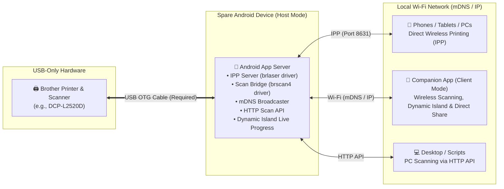

<div align="center">

<h2>🖨️ BrotherBridge (Releasing on 27 Nov 2026)</h2>

**Breathe new life into your old USB-only Brother printer & scanner using a spare Android phone.**

</div>

*Turn any old Android device + USB OTG cable into a wireless IPP Print Server (`brlaser`) and High-Resolution Network Scanner (`brscan4`).*

<div align="center">

[](#)
[](#)
[](#)
[](#)


[Features](#-key-features) • [How It Works](#-architecture) • [Host Rules](#%EF%B8%8F-host-mode-rules--requirements) • [Screenshots](#-screenshots) • [Compatibility](#-compatibility--expected-devices) • [Setup Guide](#-quick-start-guide) • [HTTP API](#-pc-scanning-http-api)

---

</div>

## 🌟 Overview

Many rock-solid monochrome laser printers and multifunction scanners—like the **Brother DCP-L2520D**—still work flawlessly after years of use, yet lack built-in Wi-Fi. Instead of replacing a great printer or maintaining a Raspberry Pi / always-on PC, you can repurpose a spare Android phone sitting in your drawer.

By connecting your printer to an Android device via a **USB OTG cable**, this app turns the phone into a dedicated **Wi-Fi Print & Scan Server** powered under the hood by **`brlaser`** (printing) and **`brscan4`** (scanning):

* **Wireless Printing (IPP + `brlaser`):** Print directly from Android, iOS, Windows, macOS, and Linux over Wi-Fi—no extra drivers or client apps needed on the printing device.
* **Wireless Scanning (`brscan4`):** Scan documents wirelessly at up to **2400 DPI** using the same app in **Client Mode**, or trigger scans directly from your PC via the built-in **HTTP API**.
* **Modern Dynamic Island UI:** Track live printing and scanning progress at a glance in an interactive Dynamic Island pill, and **share scanned files directly** the moment a scan completes.

---

## 🏗️ Architecture



---

## ✨ Key Features

### 🏝️ Modern Dynamic Island & Instant Sharing
* **Live Job Progress:** A sleek, modern **Dynamic Island** overlay/live activity displays real-time progress for both active **printing** and **scanning** jobs without blocking what you're doing.
* **One-Tap Direct Share:** As soon as a wireless scan finishes, share the resulting **JPG**, **PNG**, or **PDF** directly from the Dynamic Island to WhatsApp, Email, Google Drive, or any other app.

### 🖨️ Wireless Printing (`brlaser` + IPP)
* **Standard IPP Support:** Uses the Internet Printing Protocol (IPP) backed by the **`brlaser`** driver engine, allowing native wireless printing from virtually any modern OS without installing proprietary Brother drivers on client devices.
* **Zero-Config Discovery:** Broadcasts automatically on your local network via **mDNS (Bonjour / ZeroConf)**, with manual **IP address** fallback.

### 📄 High-Resolution Wireless Scanning (`brscan4`)
* **Up to 2400 DPI:** Capture crisp text, graphics, and fine details with selectable resolution presets all the way up to **2400 DPI**.
* **2-in-1 ID Card Scanning:** Dedicated workflow to scan the front and back of ID cards, licenses, or passports and automatically arrange them neatly onto a single page.
* **Continuous Multi-Page Scanning:** Keep scanning page after page in a single session to seamlessly compile multi-page PDF documents.
* **Flexible Export Formats:** Save and share your scans as **JPG**, **PNG**, or **PDF**.
* **PC Scanning via HTTP API:** Integrate with your desktop workflow or scripts to pull scans straight to your computer over the network.

---

## ⚠️ Host Mode Rules & Requirements

To ensure reliable, uninterrupted operation as a wireless print and scan server, **Host Mode enforces two strict requirements**:

| Rule | Requirement | Why It's Required |
| :--- | :--- | :--- |
| **1. Active USB OTG Connection** | The host Android device **must** support USB OTG and be physically connected to the Brother printer/scanner via an OTG cable/adapter. | Host Mode cannot start or serve devices without an active USB OTG hardware link and granted Android USB host permissions. |
| **2. Background Battery Usage Allowed** | You **must** allow **Unrestricted Background Battery Usage** (disable Android Battery Optimization) for the app. | Android aggressively kills background services when the screen turns off. Allowing background battery usage keeps the IPP server, mDNS broadcaster, and HTTP Scan API reachable 24/7. |

> 💡 **Pro Tip:** Since USB OTG supplies minor bus communication and keeps the phone awake, consider using a **USB OTG Power Y-Splitter / Powered Hub** (if supported by your phone) so your host Android device stays charged continuously.

---

## 📊 Capabilities at a Glance

| Category | Capability | Details |
| :--- | :--- | :--- |
| **Connection (Host)** | USB OTG (Mandatory) | Connects directly to USB-only Brother printers/scanners |
| **Print Driver Engine** | `brlaser` | Monochrome Brother laser raster driver exposed over IPP |
| **Scan Driver Engine** | `brscan4` | Supports Brother 4th-gen scan protocol over Wi-Fi |
| **Network Discovery** | mDNS & Static IP | Auto-discoverable on LAN or connectable via direct IP |
| **Printing Protocol** | IPP | Native printing from Android, Windows, macOS, Linux, iOS |
| **Max Scan Resolution** | Up to 2400 DPI | Configurable DPI for quick drafts or archival quality |
| **Special Scan Modes** | 2-in-1 ID & Continuous | Front/back ID layout & multi-page document builder |
| **Export Formats** | JPG, PNG, PDF | Single image exports and multi-page PDF compilation |
| **Live UI & Sharing** | Modern Dynamic Island | Real-time print/scan progress + direct scan file sharing |
| **PC Integration** | HTTP API | Trigger and download scans from any PC on the same Wi-Fi |

---

## 📸 Screenshots

> *Screenshots will be attached here soon.*

| Host Server Dashboard | Dynamic Island Progress & Share | Wireless Scan Client | 2-in-1 ID & Multi-Page PDF |
| :---: | :---: | :---: | :---: |
|  |  |  |  |
| *OTG status, battery check, IP & mDNS info* | *Live print/scan pill & direct file share* | *Up to 2400 DPI & live scan preview* | *2-in-1 ID alignment & continuous PDF* |

---

## ✅ Compatibility & Expected Devices

> ⚠️ **Testing Notice:** This app was built for **Brother DCP-L2520D**-class devices and has currently **only been verified on the Brother DCP-L2520D**. Because it uses the **`brlaser`** driver for printing and **`brscan4`** for scanning, the devices listed below are **expected to work**, though they remain untested by the author.

### 1. Tested & Confirmed
| Model | Print (`brlaser`) | Scan (`brscan4`) | Status |
| :--- | :---: | :---: | :--- |
| **Brother DCP-L2520D** | ✅ Tested | ✅ Tested | Primary development & verified test device |

### 2. Expected Full Compatibility (Print + Scan)
*Multifunction monochrome laser printers supported by **both** `brlaser` and `brscan4`:*

| Brother Series | Expected Models | Print (`brlaser`) | Scan (`brscan4`) |
| :--- | :--- | :---: | :---: |
| **DCP-L2500 Series** | `DCP-L2500D`, `DCP-L2510D`, `DCP-L2520DW`, `DCP-L2540DW`, `DCP-L2550DW` | 🟡 Expected | 🟡 Expected |
| **DCP-1500 / 1600 Series** | `DCP-1510`, `DCP-1512`, `DCP-1600`, `DCP-1610W` | 🟡 Expected | 🟡 Expected |
| **DCP-7055–7080 Series** | `DCP-7055`, `DCP-7055W`, `DCP-7060D`, `DCP-7065DN`, `DCP-7070DW`, `DCP-7080` | 🟡 Expected | 🟡 Expected |
| **MFC-1800 / 1900 Series** | `MFC-1810`, `MFC-1815`, `MFC-1910W` | 🟡 Expected | 🟡 Expected |
| **MFC-7000 Series** | `MFC-7240`, `MFC-7360N`, `MFC-7365DN`, `MFC-7460DN`, `MFC-7860DW` | 🟡 Expected | 🟡 Expected |
| **MFC-L2700 Series** | `MFC-L2700DN`, `MFC-L2700DW`, `MFC-L2710DN`, `MFC-L2710DW`, `MFC-L2750DW` | 🟡 Expected | 🟡 Expected |

### 3. Expected Partial Compatibility (Print-Only or Scan-Only)
| Category | Expected Models | Print (`brlaser`) | Scan (`brscan4`) | Notes |
| :--- | :--- | :---: | :---: | :--- |
| **Brother HL Laser Printers** | `HL-1110`, `HL-1200`, `HL-2030`, `HL-2130`, `HL-2140`, `HL-2220`, `HL-2240D`, `HL-2270DW`, `HL-5030`, `HL-L2300D`, `HL-L2320D`, `HL-L2340D`, `HL-L2360D`, `HL-L2375DW`, `HL-L2390DW` | 🟡 Expected | ➖ N/A | Single-function printers (no scanner hardware) |
| **Older `brscan3` MFPs** | `DCP-7030`, `DCP-7040`, `MFC-7320`, `MFC-7340`, `MFC-7420`, `MFC-7440N` | 🟡 Expected | ❌ Unsupported | Printing uses `brlaser`, but scanning requires `brscan3` |
| **Other `brscan4` Inkjet / Color MFPs** | USB `DCP-T`, `DCP-J`, `MFC-J` series listed under Brother `brscan4` | ❌ Unsupported | 🟡 Expected | `brlaser` supports monochrome lasers only; scanning may still work |

*Tested this app on another Brother model? Please open an **Issue** or **Pull Request** with your model number and results so we can update this compatibility matrix!*

---

## 🚀 Quick Start Guide

### Prerequisites
* A compatible USB-only Brother printer/scanner (e.g., **DCP-L2520D**).
* A spare Android device (Host) with **USB OTG** hardware support.
* A **USB OTG adapter/cable** *(or powered OTG Y-splitter cable)*.
* A shared Wi-Fi network for your Host Android device and your Client devices.

### 1. Set Up the Host Device (Server)
1. Install the app on your spare Android device.
2. Connect your Brother printer to the Android device via the **USB OTG cable**.
3. Open the app and grant **USB Device Permissions** when prompted.
4. Grant **Unrestricted Background Battery Usage** when prompted *(mandatory for Host Mode)*.
5. Enable **Host Mode** to start the Print & Scan Server.
6. Note the displayed **IP Address** (or rely on automatic **mDNS** discovery).

### 2. Print Wirelessly (IPP)
* **Android / iOS / macOS / Windows / Linux:** Open your system's Print dialog—your Brother printer should appear automatically via **mDNS**.
* If it does not appear automatically, add a network printer manually using the IPP URL shown in the app (e.g., `ipp://<HOST_IP>:<PORT>/ipp/print`).
* Watch real-time printing progress right in the **Dynamic Island**.

### 3. Scan Wirelessly (Mobile Client)
1. Install the same app on your daily Android phone/tablet.
2. Open **Client / Scanner Mode**.
3. Select your host server from the auto-discovered **mDNS list** (or enter the Host IP manually).
4. Choose your **DPI** (up to **2400 DPI**), **Scan Mode** (Standard, 2-in-1 ID, or Continuous Multi-Page), and tap **Scan**.
5. Monitor live scanning progress in the **Dynamic Island**, then **directly share** or save your document as **JPG**, **PNG**, or **PDF**.

---

## 💻 PC Scanning (HTTP API)

Trigger scans directly from Windows, macOS, or Linux without installing `brscan4` drivers on your computer by calling the Host device's built-in HTTP API.

*(Update the endpoints, ports, and payload keys below to match your exact implementation)*

| Method | Endpoint | Description |
| :--- | :--- | :--- |
| `GET` | `/api/status` | Check USB OTG connection, model info, and server health |
| `POST` | `/api/scan` | Trigger a scan with custom DPI, color mode, and output format |

### Example Request (`curl`)
```bash
# Example: Trigger a 300 DPI color scan and save as a PNG
curl -X POST "http://<HOST_IP>:<PORT>/api/scan" \
  -H "Content-Type: application/json" \
  -d '{
    "dpi": 300,
    "mode": "color",
    "format": "png"
  }' \
  --output scanned_document.png
```

---

## 🛠️ Troubleshooting

* **Host Mode won't start?** Verify both mandatory rules: (1) the printer is powered on and physically connected via a working **USB OTG cable**, and (2) **Background Battery Usage** is set to *Unrestricted* in Android App Info → Battery.
* **Server disconnects when screen is off?** Some Android OEMs (Xiaomi/MIUI, Samsung, OnePlus, Vivo, Oppo) have aggressive battery savers. Lock the app in Recent Apps and disable "Pause app activity if unused" in addition to granting Unrestricted Battery permission.
* **mDNS Not Showing Up?** Some Wi-Fi routers block multicast/mDNS traffic across bands (2.4 GHz vs 5 GHz) or enable "AP Isolation." Connect directly using the Host device's local IP address instead.

---

## 🤝 Contributing

Contributions, bug reports, and **printer/scanner compatibility reports** are warmly welcome!

1. Fork the repository.
2. Create a feature branch (`git checkout -b feature/amazing-feature`).
3. Commit your changes (`git commit -m 'Add amazing feature'`).
4. Push to the branch (`git push origin feature/amazing-feature`).
5. Open a Pull Request.

## License

This project is licensed under the **GNU General Public License v2.0 (GPL-2.0)** — see the [LICENSE](LICENSE) file for details.

### Third-Party Attributions & Derivative Works

This application includes Kotlin ports and adaptations of open-source C/C++ printer and scanner drivers:

* **Printing (`brlaser`)** — Ported from [brlaser](https://github.com/pdewacht/brlaser) (licensed under GPL-2.0-or-later).
* **Scanning (`brscan4`)** — Ported from open-source C implementations of the Brother SANE `brscan4` protocol (licensed under GPL-2.0).

*Disclaimer: This is an independent open-source project and is not affiliated with, endorsed by, or supported by Brother Industries, Ltd. All product names and trademarks belong to their respective owners.*
